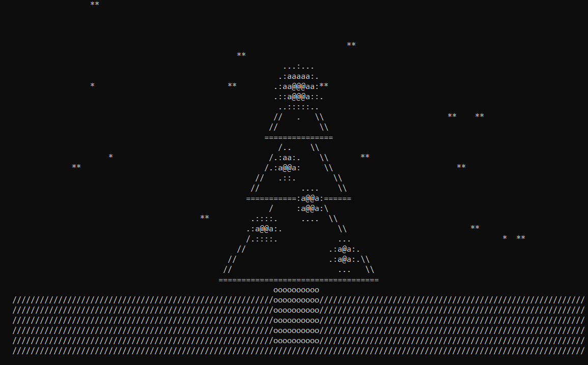

# **2D Graphics engine**

## This is very basic (if it right to say so) 2d graphics engine made fully in console. It has 3 shapes: line, rectangle and gradient circle. It comes with one example animation.
What it does is basicly rendering some 2d shapes in terminal, shapes can be moved, their size, texture and position can be defined on initialization of a shape. As said, shapes can be moved, therefore animation is possible. There is no actual useful usage, it is made just for fun. 
## **Quick start**
- Download source code and unzip it somewhere.
- Comple it via running this command in project folder javac -d out src/*.java 
- Make a jar file via command *jar cfe graphics.jar Main -C out .*
- Set in ur terminal preferences witdh 130 symbols and height 50 symbols.
- Run via *java -jar graphics.jar*
*By default this runs an example animation.*

